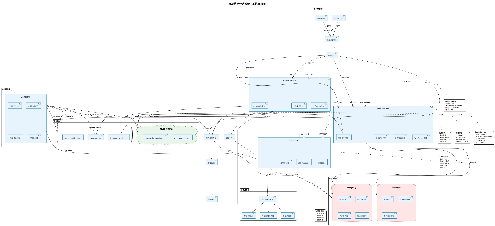
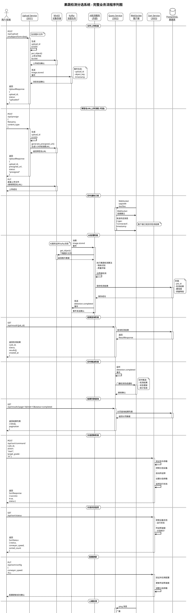
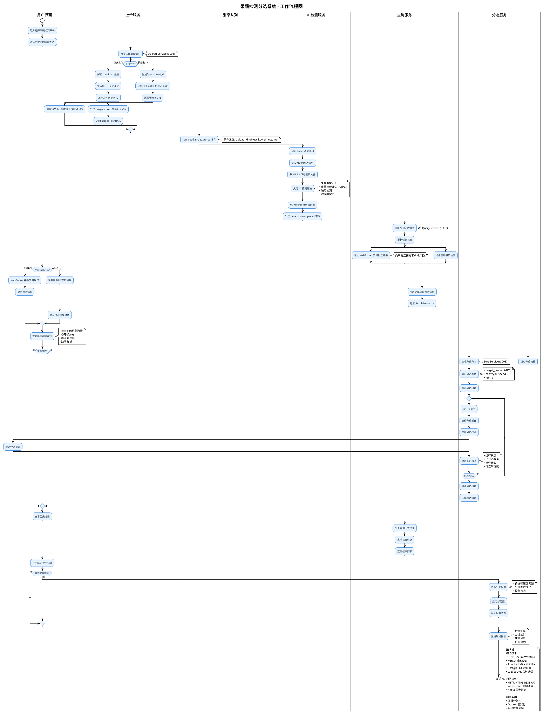
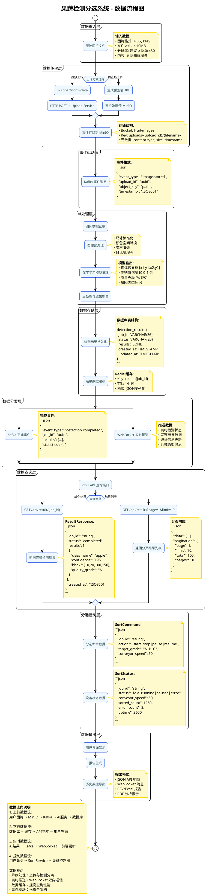

# 果蔬检测分选系统 - 后端架构文档

## 📋 项目概述

本项目是一个基于 Rust 微服务架构的果蔬检测分选系统后端，集成了 AI 图像识别、对象存储、消息队列和实时通信等技术，为果蔬质量检测和自动分选提供完整的后端支持。

## 🏗️ 系统架构

### 核心服务组件

1. **Upload Service (上传服务)** - 端口 3001

   - 处理图片文件上传
   - 支持直接上传和预签名 URL 上传
   - 集成 MinIO 对象存储
   - 发送 Kafka 事件通知

2. **Query Service (查询服务)** - 端口 3002

   - 提供检测结果查询 API
   - 支持分页和状态筛选
   - WebSocket 实时数据推送
   - 结果缓存管理

3. **Sort Service (分选服务)** - 端口 3003
   - 分选设备控制
   - 状态监控和配置管理
   - 分选命令处理

### 技术栈

- **后端框架**: Rust + Axum
- **对象存储**: MinIO (S3 兼容)
- **消息队列**: Apache Kafka
- **数据库**: PostgreSQL + Redis 缓存
- **实时通信**: WebSocket
- **容器化**: Docker

## 📊 系统图表

### 系统架构图

展示整个系统的高层架构和组件关系：



### 序列图

展示完整的业务流程时序：



### 工作流图

展示系统的处理流程：



### 数据流图

展示数据在系统中的流向：



## 🔄 业务流程

### 1. 图片上传阶段

- 用户通过前端上传果蔬图片
- 支持两种上传方式：
  - **直接上传**: multipart/form-data → Upload Service → MinIO
  - **预签名上传**: 生成预签名 URL → 客户端直传 MinIO

### 2. AI 检测处理

- Kafka 事件触发 AI 服务处理
- AI 服务从 MinIO 下载图片
- 执行果蔬检测算法（物体识别、质量评级、边界框检测）
- 结果存储到 PostgreSQL 数据库

### 3. 结果查询和推送

- 查询服务提供 REST API 查询结果
- WebSocket 实时推送检测完成通知
- 支持分页查询历史记录

### 4. 分选控制

- 分选服务控制物理分选设备
- 支持启动、停止、暂停、恢复操作
- 实时监控分选状态和统计

## 🚀 快速开始

### 环境要求

- Rust 1.70+
- Docker & Docker Compose
- PostgreSQL 14+
- Redis 6+
- Apache Kafka 2.8+
- MinIO

### 启动服务

1. **启动依赖服务**:

```bash
# 启动 PostgreSQL, Redis, Kafka, MinIO
docker-compose up -d postgres redis kafka minio
```

2. **启动所有后端服务**:

```bash
./run-all.sh
```

3. **单独启动服务**:

```bash
# 上传服务
cargo run --bin upload-svc

# 查询服务
cargo run --bin query-svc

# 分选服务
cargo run --bin sort-svc
```

## 📡 API 接口

### Upload Service (3001)

- `POST /api/v1/uploads` - 直接上传文件
- `POST /api/v1/uploads/presign` - 生成预签名 URL
- `GET /health` - 健康检查

### Query Service (3002)

- `GET /api/v1/results/{job_id}` - 获取检测结果
- `GET /api/v1/results` - 分页查询结果列表
- `GET /ws/live` - WebSocket 实时推送
- `GET /health` - 健康检查

### Sort Service (3003)

- `POST /api/v1/sort/command` - 发送分选命令
- `GET /api/v1/sort/status` - 获取分选状态
- `PUT /api/v1/sort/config` - 更新配置
- `GET /health` - 健康检查

## 🔧 开发工具

### UML 图表生成

使用 PlantUML 生成项目架构图：

```bash
# 生成所有图表
./generate-diagrams.sh

# 生成特定图表
./generate-diagrams.sh sequence    # 序列图
./generate-diagrams.sh architecture # 架构图
./generate-diagrams.sh workflow     # 工作流图
./generate-diagrams.sh dataflow     # 数据流图
```

### 代码质量

```bash
# 格式化代码
cargo fmt

# 静态检查
cargo clippy

# 运行测试
cargo test
```

## 📝 数据结构

### 核心数据模型

#### UploadResponse

```rust
pub struct UploadResponse {
    pub upload_id: String,
    pub presigned_url: Option<String>,
    pub status: String,
}
```

#### ResultResponse

```rust
pub struct ResultResponse {
    pub job_id: String,
    pub status: String,
    pub results: Vec<DetectionResult>,
    pub created_at: String,
}
```

#### DetectionResult

```rust
pub struct DetectionResult {
    pub class_name: String,     // 物体类别
    pub confidence: f32,        // 置信度 0.0-1.0
    pub bbox: Vec<f32>,         // 边界框 [x1,y1,x2,y2]
    pub quality_grade: String,  // 质量等级 A/B/C
}
```

#### SortCommand

```rust
pub struct SortCommand {
    pub job_id: String,
    pub action: String,              // start/stop/pause/resume
    pub target_grade: Option<String>, // A/B/C
    pub conveyor_speed: Option<u32>,  // 0-100
}
```

## 🔐 安全考虑

- **身份验证**: 预留 JWT 令牌验证机制
- **输入验证**: 严格的文件类型和大小检查
- **网络安全**: CORS 配置和 HTTPS 支持
- **数据加密**: 敏感数据传输加密

## 📈 性能优化

- **异步处理**: 基于 Tokio 的异步运行时
- **连接池**: 数据库连接池管理
- **缓存策略**: Redis 缓存热点数据
- **负载均衡**: 支持水平扩展

## 🐳 部署方案

### Docker 部署

```bash
# 构建镜像
docker build -t upload-svc ./upload-svc
docker build -t query-svc ./query-svc
docker build -t sort-svc ./sort-svc

# 运行容器
docker-compose up -d
```

### Kubernetes 部署

参考 `k8s/` 目录中的配置文件

## 📊 监控和日志

- **日志框架**: tracing + tracing-subscriber
- **指标收集**: 预留 Prometheus 指标接口
- **健康检查**: 所有服务提供 `/health` 端点
- **分布式追踪**: 支持 trace_id 关联

## 🤝 贡献指南

1. Fork 项目
2. 创建功能分支 (`git checkout -b feature/AmazingFeature`)
3. 提交更改 (`git commit -m 'Add some AmazingFeature'`)
4. 推送到分支 (`git push origin feature/AmazingFeature`)
5. 开启 Pull Request

## 📄 许可证

本项目采用 MIT 许可证 - 查看 [LICENSE](LICENSE) 文件了解详情

## 🆘 故障排除

### 常见问题

1. **服务启动失败**

   - 检查端口是否被占用
   - 确认依赖服务状态
   - 查看服务日志

2. **图片上传失败**

   - 验证 MinIO 连接配置
   - 检查存储桶权限
   - 确认文件大小限制

3. **WebSocket 连接断开**
   - 检查网络连接
   - 验证 CORS 配置
   - 查看客户端实现

### 日志查看

```bash
# 查看服务日志
cargo run --bin upload-svc 2>&1 | tee upload.log
cargo run --bin query-svc 2>&1 | tee query.log
cargo run --bin sort-svc 2>&1 | tee sort.log
```

---

## 📞 联系方式

如有问题或建议，请通过以下方式联系：

- 项目 Issues: [GitHub Issues](https://github.com/lanshi17/guoyan-zhizao/issues)
- 邮箱: [项目邮箱]
- 文档: [项目 Wiki](https://github.com/lanshi17/guoyan-zhizao/wiki)

---

_最后更新: 2025 年 10 月 4 日_
